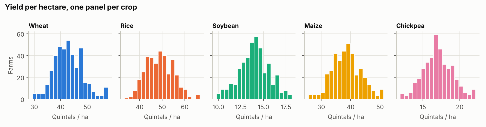
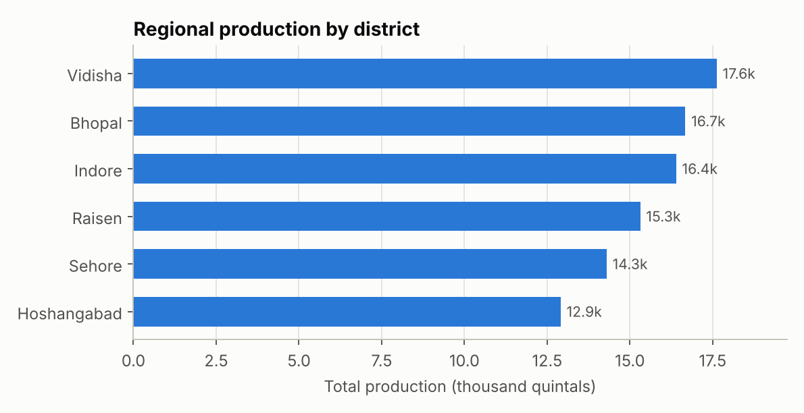
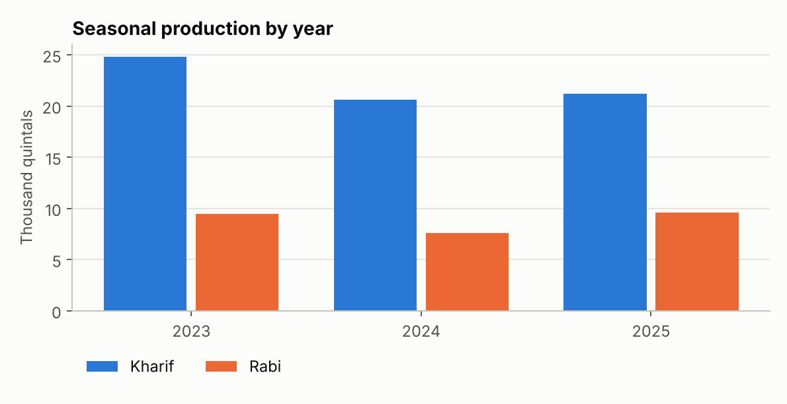
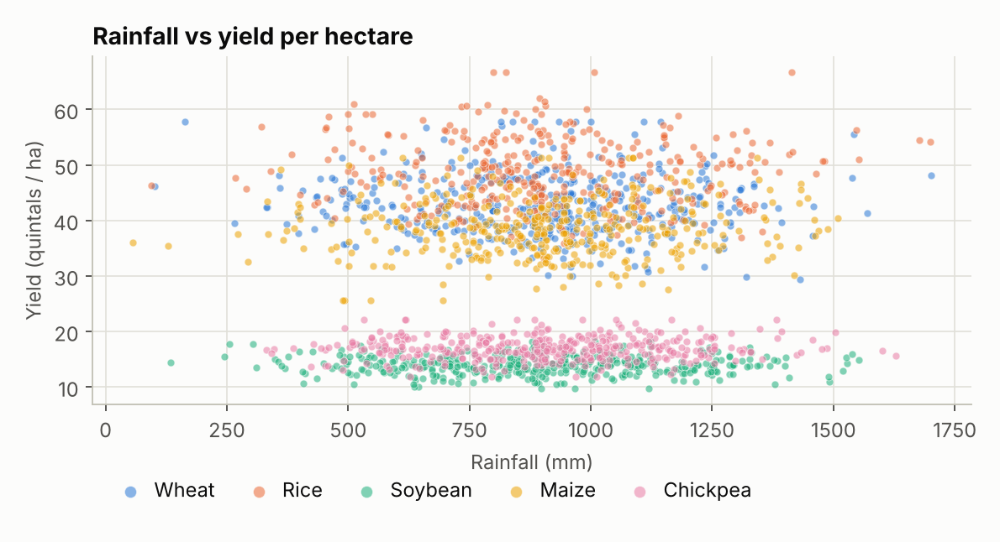
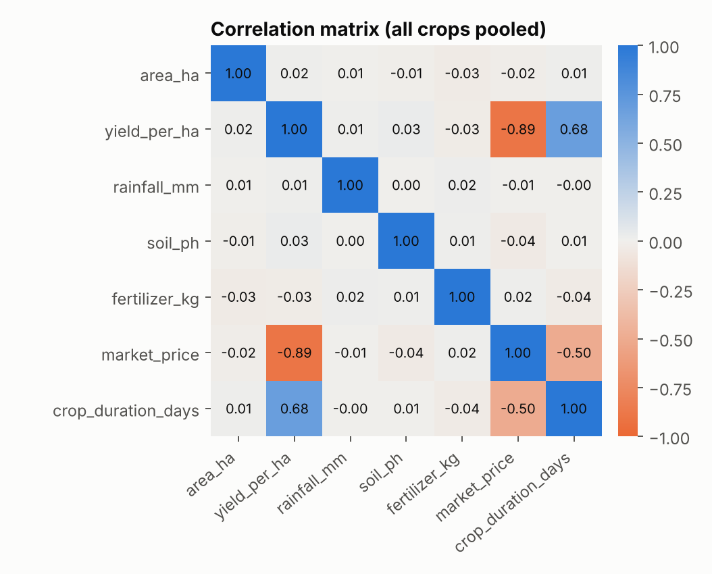
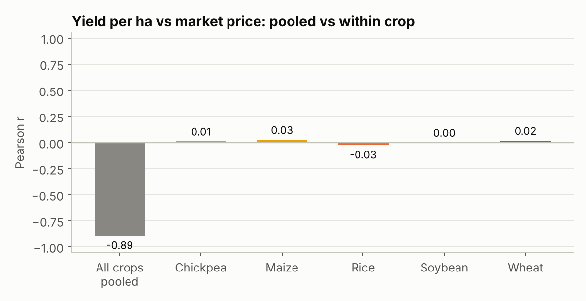
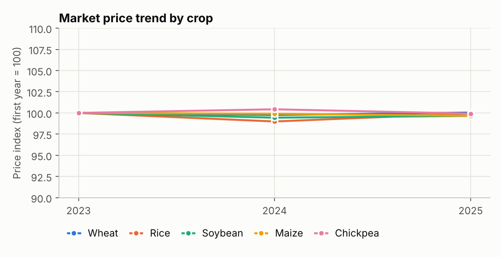
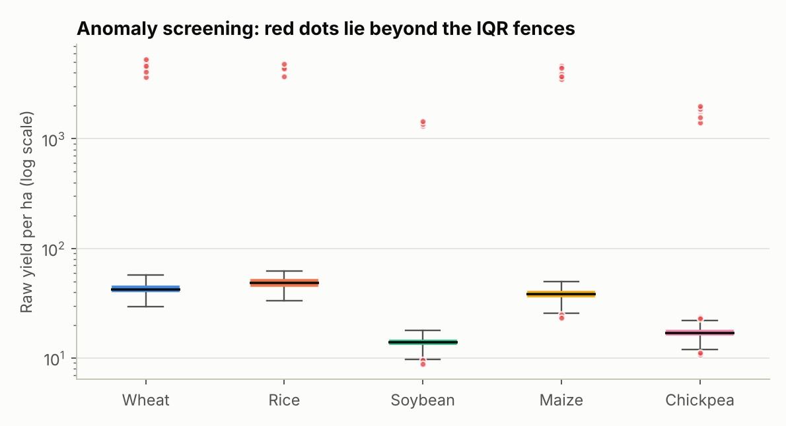

# Exploratory Data Analysis Report: Agribusiness Trends

_Generated on 13 October 2026 from `agri_clean_sample.csv` (1,960 records, 6 districts, 5 crops, 3 years)._

## 1. Executive summary

- Vidisha has the highest production (17,624 quintals, 18.9% of the total) and Hoshangabad the lowest (12,908); the top district produces 37% more.
- Kharif season accounts for 71% of production, so output depends heavily on one season.
- Rice earns the most per hectare (about INR 106,794), while soybean earns the least (about INR 64,397).
- The pooled correlation between yield per hectare and price is -0.893, but within each crop it never exceeds 0.029 in absolute value: the pooled figure comes from crop mix, not a real link.
- 40 of 1,960 records (2.0%) were flagged as yield anomalies; 31 were caught by both the IQR rule and the modified Z-score.

## 2. Introduction and objectives

This report explores cleaned farm-level data to answer five questions: where production is concentrated, how production and prices change over seasons and years, which factors go with higher yield, which crops carry the most price risk, and which records look unusual enough to verify.

## 3. Data description

- Records: **1,960**; districts: **Bhopal, Hoshangabad, Indore, Raisen, Sehore, Vidisha**
- Crops: **chickpea, maize, rice, soybean, wheat**; years: **2023, 2024, 2025**
- Total area: **2,917 ha**; total production: **93,217 quintals**

Share of values that were imputed during cleaning (%), by district:

| district | soil_ph | rainfall_mm | fertilizer_kg | market_price | yield_qtl | harvest_date |
|---|---|---|---|---|---|---|
| Bhopal | 8.1 | 6.1 | 5.8 | 3.5 | 2.3 | 3.2 |
| Hoshangabad | 11.0 | 5.7 | 9.4 | 4.7 | 2.7 | 5.4 |
| Indore | 8.6 | 5.8 | 10.1 | 2.8 | 2.1 | 3.4 |
| Raisen | 8.0 | 6.8 | 10.2 | 4.3 | 1.5 | 4.6 |
| Sehore | 8.4 | 5.9 | 11.5 | 4.7 | 1.9 | 4.4 |
| Vidisha | 9.6 | 4.9 | 11.6 | 4.4 | 1.7 | 3.2 |

## 4. Methodology

- Medians and the interquartile range are reported next to means because yield data is skewed.
- Yield and price are compared **within each crop**; pooled results are always checked against within-crop results.
- Anomalies use two signals per crop: the IQR rule (1.5 x IQR) and the modified Z-score (above 3.5, median/MAD).
- Group differences use the Kruskal-Wallis test with a Bonferroni correction across crops.
- Redundancy between numeric variables is checked with the variance inflation factor (VIF).

## 5. Univariate analysis

| crop_type | records | mean | median | std | iqr | skew | cv |
|---|---|---|---|---|---|---|---|
| chickpea | 393 | 17.03 | 16.88 | 2.01 | 2.57 | 0.15 | 0.12 |
| maize | 384 | 38.59 | 38.43 | 4.99 | 6.42 | 0.17 | 0.13 |
| rice | 355 | 48.82 | 48.71 | 6.02 | 9.03 | 0.28 | 0.12 |
| soybean | 416 | 13.97 | 13.96 | 1.65 | 2.09 | -0.03 | 0.12 |
| wheat | 412 | 42.88 | 42.31 | 5.44 | 7.50 | 0.41 | 0.13 |

## 6. Regional and seasonal analysis

| district | farms | total_qtl | area_ha | median_yield_per_ha | share_pct |
|---|---|---|---|---|---|
| Vidisha | 344 | 17,624.46 | 547.29 | 37.74 | 18.91 |
| Bhopal | 345 | 16,675.86 | 521.36 | 36.40 | 17.89 |
| Indore | 326 | 16,397.99 | 498.19 | 36.56 | 17.59 |
| Raisen | 325 | 15,311.88 | 483.83 | 35.83 | 16.43 |
| Sehore | 321 | 14,298.29 | 446.60 | 36.31 | 15.34 |
| Hoshangabad | 299 | 12,908.30 | 420.04 | 34.37 | 13.85 |

| season_year | season | total_qtl | share_of_year_pct | yoy_change_pct |
|---|---|---|---|---|
| 2023 | kharif | 24,786.05 | 72.31 | nan |
| 2023 | rabi | 9,489.78 | 27.69 | nan |
| 2024 | kharif | 20,599.42 | 73.07 | -16.89 |
| 2024 | rabi | 7,592.22 | 26.93 | -20.00 |
| 2025 | kharif | 21,179.07 | 68.88 | 2.81 |
| 2025 | rabi | 9,570.25 | 31.12 | 26.05 |

**Do districts differ in yield per hectare within a crop?** (Kruskal-Wallis, Bonferroni-adjusted)

| crop_type | districts | H | p_value | p_adjusted | significant_5pct |
|---|---|---|---|---|---|
| chickpea | 6 | 8.39 | 0.14 | 0.68 | False |
| maize | 6 | 1.03 | 0.96 | 1.00 | False |
| rice | 6 | 1.38 | 0.93 | 1.00 | False |
| soybean | 6 | 8.32 | 0.14 | 0.70 | False |
| wheat | 6 | 5.72 | 0.33 | 1.00 | False |

## 7. Relationships and drivers

### Is the strongest correlation real?

Pooled across all crops, `yield_per_ha` and `market_price` have a correlation of **-0.893**. Within each crop:

| crop_type | n | r |
|---|---|---|
| chickpea | 393 | 0.01 |
| maize | 384 | 0.03 |
| rice | 355 | -0.03 |
| soybean | 416 | 0.00 |
| wheat | 412 | 0.02 |

The pooled value is **an effect of crop mix** (a confounding variable; Simpson's paradox), not a real link, so it should not be reported as an insight.

**Variance inflation factors** (values above 5 to 10 suggest redundant variables):

| variable | vif |
|---|---|
| area_ha | 1.00 |
| yield_per_ha | 4.93 |
| rainfall_mm | 1.00 |
| soil_ph | 1.00 |
| fertilizer_kg | 1.00 |
| market_price | 4.93 |

## 8. Price and profitability

| crop_type | mean_price | price_std | mean_yield_per_ha | price_cv_pct | revenue_per_ha |
|---|---|---|---|---|---|
| rice | 2,187.52 | 68.05 | 48.82 | 3.11 | 106,794.27 |
| wheat | 2,275.09 | 68.74 | 42.88 | 3.02 | 97,561.04 |
| chickpea | 5,436.92 | 158.09 | 17.03 | 2.91 | 92,569.15 |
| maize | 2,088.75 | 63.06 | 38.59 | 3.02 | 80,614.85 |
| soybean | 4,611.09 | 130.87 | 13.97 | 2.84 | 64,396.89 |

## 9. Anomalies and data issues

| crop_type | records | iqr_flagged | mod_z_flagged | both |
|---|---|---|---|---|
| chickpea | 393 | 11 | 7 | 7 |
| maize | 384 | 11 | 8 | 8 |
| rice | 355 | 4 | 4 | 4 |
| soybean | 416 | 5 | 3 | 3 |
| wheat | 412 | 9 | 9 | 9 |

Ten most extreme flagged records (raw yield per hectare before capping):

| farm_id | district | crop_type | yield_per_ha_raw | mod_z |
|---|---|---|---|---|
| F2529 | Indore | chickpea | 1,990.99 | 1,025.45 |
| F2361 | Raisen | wheat | 5,285.71 | 992.17 |
| F2460 | Hoshangabad | maize | 4,632.01 | 964.65 |
| F1512 | Sehore | chickpea | 1,870.69 | 962.96 |
| F1368 | Bhopal | wheat | 5,106.84 | 958.32 |
| F1018 | Vidisha | chickpea | 1,849.06 | 951.72 |
| F1227 | Indore | soybean | 1,451.61 | 928.56 |
| F2147 | Hoshangabad | maize | 4,419.05 | 919.93 |
| F1385 | Vidisha | wheat | 4,864.07 | 912.38 |
| F1354 | Sehore | chickpea | 1,766.67 | 908.92 |

Flagged records are not deleted. Each one should be checked against its source; if it cannot be verified it stays flagged and results are reported with and without it.

## 10. Insights and recommendations

_Rule-based starting points. Each should be confirmed with a domain expert before action._

- Review agronomy support and input supply in Hoshangabad, which has the lowest median yield per hectare (34.4 quintals); first check whether crop mix explains the gap.
- Plan storage and transport for the kharif peak (71% of output) and look at ways to spread risk across seasons.
- Watch price risk for rice (coefficient of variation 3.1%), the most volatile crop in this data.
- Verify the flagged yield records at the source before using them for decisions (see the anomaly section).
- Improve data collection in Hoshangabad, where the largest share of values had to be imputed (6.5% on average).

## 11. Limitations and next steps

- If the input is synthetic (as the bundled sample is), the numbers show how the method works and are not real agricultural findings.
- A few years of data cannot separate a trend from normal year-to-year variation.
- Imputed values can weaken real relationships; rerun key results on complete records only.
- Next steps: add weather and soil-type data, test lagged rainfall effects, and build a yield forecasting model on the variables that survive the within-crop checks.
